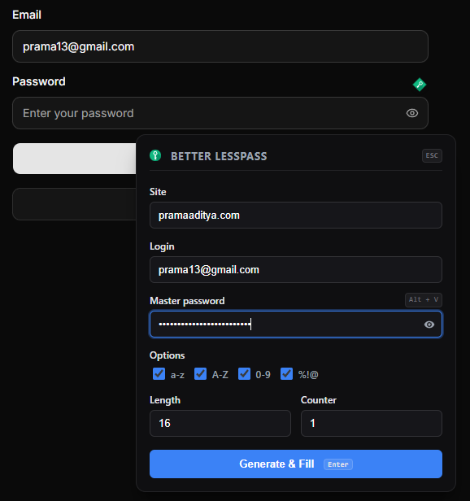
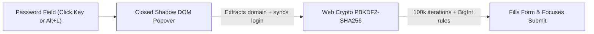

<p align="center">
  
</p>

<h1 align="center">Better LessPass</h1>

<p align="center">
  <b>Stateless LessPass password generation directly inside every password field — zero toolbar clicks, zero copy-paste.</b>
  <br>
  A zero-dependency Chrome extension (Manifest V3) powered by Web Crypto PBKDF2-SHA256, smart domain extraction, and a keyboard-first closed Shadow DOM popover.
</p>

<p align="center">
  
  
  
  
  
</p>

<br>

---

<p align="center">
  
</p>

<br>

---

## Why Leave the Password Field to Generate a Password?

You land on a login form with your email already filled in. With the official LessPass Chrome extension, the password input just sits there — there is no inline button attached to the field.

So you leave the form, click the extension icon in the browser toolbar, verify the site domain, type your login and master password, generate, copy, click back into the page, and paste. Every single sign-in turns a two-second form into a five-step detour.

**Better LessPass brings the entire LessPass generator directly onto the password field — trigger, sync, generate, and submit without ever touching the toolbar.**

Here is the end-to-end flow from password field focus to form submission:



- **Inline trigger that avoids native UI:** Floats a 22px emerald key button just above the top-right corner of every `input[type="password"]` so it never covers a site's built-in password-reveal eye icon (tucking inside only when the input sits near the top edge of the viewport).
- **Smart registered-domain extraction:** Strips subdomains like `app.sub.github.com` down to `github.com` while preserving common two-part public suffixes (`.co.uk`, `.com.au`, `.ac.id`, `.edu.sg`), remaining editable in the `Site` input anytime.
- **Bidirectional login sync:** Automatically pulls an existing email or username from the page form into `Login` when opened, and writes `Login` back to the page's username field on generation.
- **Zero-friction keyboard loop:** Press `Alt+L` on a password field to open with `Master password` auto-focused, hit `Enter` to generate and fill both fields, and land focus directly on the form's submit button.

<br>

---

## Try It in 10 Seconds (Zero Config)

No build step, no npm install, and no account required — load the extension unpacked straight from source:

```bash
# Clone the repository locally
git clone https://github.com/PramaAditya/better-lesspass.git
```

1. Open `chrome://extensions/` in Google Chrome and enable **Developer mode** (top-right).
2. Click **Load unpacked** and select the cloned `better-lesspass/` folder.
3. Visit any `https://` login page—or serve the folder over local HTTP (since [`manifest.json`](manifest.json) injects [`content.js`](content.js) on `http://*/*` and `https://*/*`, not `file://`) with `python3 -m http.server 8000` or `npx serve -l 8000 .` and open `http://localhost:8000/test.html`—then click the green key icon above the password input or press `Alt+L` inside the field.

<br>

---

## Security & Architecture

Better LessPass derives passwords 100% locally via `window.crypto.subtle` (`PBKDF2-SHA256`, `100,000` iterations, `32`-byte key) and deterministic `BigInt` character-class distribution (`a-z`, `A-Z`, `0-9`, `%!@`, configurable length `6–35` and counter).

### 1. Isolated Closed Shadow DOM

The trigger button and popover live inside a `closed` Shadow Root (`attachShadow({ mode: 'closed' })`) with `Tab`/`Shift+Tab` focus trapping, preventing host-page CSS from breaking the layout and blocking page scripts from inspecting popover DOM state.

### 2. Storage & Session Memory Boundaries

| Data | Storage Mechanism | Persistence |
| :--- | :--- | :--- |
| **Character options, Length, Counter** | `chrome.storage.local` | Persists across browser restarts |
| **Master password (session cache)** | `chrome.storage.session` via [`background.js`](background.js) | Automatic across the browser session (no disable toggle); cleared on browser close |
| **Generated password** | Never stored | Injected directly into the page input |

- **Minimal permissions:** [`manifest.json`](manifest.json) requests only `storage` (zero network calls, no `tabs` or `history` access) and injects [`content.js`](content.js) on `http://*/*` and `https://*/*` with `MutationObserver` for dynamic inputs.
- **Domain extraction:** Uses a lightweight built-in suffix list rather than the full Public Suffix List, so uncommon multi-part TLDs can be adjusted in the `Site` field.

> **Master password lifecycle:** Generating clears the popover's `Master password` input right before closing, closing resets peeked visibility back to `type="password"`, and `chrome.storage.session` pre-fills newly mounted helpers on subsequent pages during the session. Dismissing via `Esc` without generating re-masks visibility while leaving the value in the closed Shadow DOM until cleared or page unload.

<br>

---

## Keyboard Shortcuts & Comparison

### Keyboard Shortcuts

| Shortcut | Where | Action |
| :--- | :--- | :--- |
| `Alt + L` | Host password input | Toggle the inline popover |
| `Alt + V` | Inside popover | Peek / hide `Master password` (auto-resets on close) |
| `Enter` | Inside popover | Generate, fill login & password, and focus submit |
| `Esc` | Inside popover | Dismiss popover and return focus to the password field |

> **Focus behavior:** `Tab`/`Shift+Tab` stay focus-trapped inside the Shadow Root; `Alt+L` opens from the host password input and moves focus into the popover, where `Esc` dismisses it and returns focus to the page field.

### Better LessPass vs. Official Extension

| Aspect | Better LessPass | Official LessPass Extension |
| :--- | :--- | :--- |
| **Trigger location** | Inline key button on every password field | Browser toolbar popup only |
| **Page login sync** | Bidirectional form detection & fill | Manual entry / clipboard copy-paste |
| **Post-fill focus** | Moves focus to form submit button | Stays in extension popup |
| **Runtime footprint** | 3 source files, zero build tools | Bundled web/extension app |

<br>

---

## Development & Testing

No compiler or bundler is needed — edit [`content.js`](content.js), [`background.js`](background.js), or [`manifest.json`](manifest.json) directly and reload the extension in `chrome://extensions/`.

- **Interactive test harness:** Serve the repo over local HTTP (`python3 -m http.server 8000` or `npx serve -l 8000 .`) and open `http://localhost:8000/test.html` (required because [`manifest.json`](manifest.json) matches `http://*/*` and `https://*/*`, not `file://`) to verify form sync, submit-button focus handoff, and `MutationObserver` detection.
- **Core files:** [`manifest.json`](manifest.json) (MV3 config), [`content.js`](content.js) (LessPass v2 crypto, field scoring, Shadow DOM UI), [`background.js`](background.js) (session-storage message handler).

<br>

---

<p align="center">
  <a href="https://github.com/PramaAditya/better-lesspass/issues">Report Bug</a> ·
  <a href="https://github.com/lesspass/lesspass">Original LessPass</a> ·
  <a href="manifest.json">Manifest V3 Config</a>
</p>

<p align="center">
  <sub>GPL-3.0 License · Built by Prama Aditya</sub>
</p>
